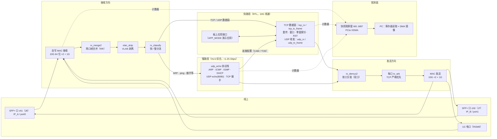

# 10g_fpga_tcp_ip_stack — 纯硬件 TCP/IP 数据面（1G 已验收，10G 已达标，PCIe 通路已打通）

## 这是什么

一块 **XCKU5P** FPGA 开发板（Kintex UltraScale+ 系列芯片，板载 2 个 SFP+ 万兆光纤插槽、1 个千兆电口、1 条 PCIe x4 插槽），
上面用 Verilog 硬件描述语言实现了一整套 **TCP/IP 协议栈数据面**：万兆光口（官方物理层 IP + 自写 64 位 MAC——
即以太网"媒体访问控制器"，负责成帧/校验的硬件模块）与千兆电口（RGMII 接口：千兆电口的标准接法）两个前端，
共用同一条 64 位数据流水线（ARM AXI-Stream 流格式：一拍拍传数据、带握手机制，每时钟周期处理一个字）。
TCP/UDP 数据段走纯硬件快路径；ARP、ping、TCP 握手等慢速控制包走用 C 语言编写、经高层综合（HLS，"用 C 代码自动生成硬件"的工具）生成的硬件协议栈。
板子插在 PC 的 PCIe 插槽上，PC 通过由 76 个 32 位寄存器组成的观察窗口读取板内计数器与状态（像读内存一样访问）——
本板没有串口，这是唯一观测手段。
项目终局目标是"TCP 卸载引擎"（TOE）：对上提供 TCP/UDP 调用接口，支撑低延迟行情接收（UDP 组播）与交易发送（TCP 少量连接）。

## 协议功能全景

| 协议 | 分层 | 实现位置 | 范围与状态 |
|---|---|---|---|
| 以太网 MAC（成帧 / FCS） | 链路层 | 自写 RTL | 10G：64 位 XGMII，线速达标（813,794.7 帧/s，载荷 9.531 Gbps）；1G：RGMII，已验收（956.0 Mbps）；双 SFP+ 第二口施工中（P2） |
| VLAN（0x8100 / 0x88A8） | 链路层 | RTL（vlan_strip） | 已实现：识别并剥离标签；带标签帧走慢路径 |
| ARP | 网络层 | HLS 慢路径 | 已实现：请求应答 |
| IPv4 | 网络层 | 快路径 RTL（数据段）+ HLS 慢路径（其余） | 单 IP 已验收；双板 IP（IP_A / IP_B）csim 已验、板级未验（P2 在施） |
| ICMP（echo） | 网络层 | HLS 慢路径 | 已实现：ping 应答 |
| IGMP v1 / v2 | 网络层 | HLS 慢路径 | 已实现；v3 不支持 |
| DHCP 客户端 | 应用层 | HLS 慢路径 | 已实现 |
| UDP | 传输层 | 快路径 RTL（收发主体）+ HLS echo（8080）参考实现 | 已验收：1G 956.0 Mbps；10G 线速达标 |
| TCP | 传输层 | 快路径 RTL（数据面）+ HLS 慢路径（握手等控制面） | 1G 已验收；10G 业务实测通过。含：被动 / 主动握手、数据收发、重传、窗口缩放、零窗探针、RST、孤儿会话回收；低速吞吐区机理未定位（见「已知边界」） |

慢路径整体限速 ≈1.25 Gbps（64 位字入、1 字节/拍出）：ARP / ping / 握手等控制面流量足够，不承载批量数据。

## 数据通路（数据流一览）

实线 = 数据流；点线 = 计数器 / 观测。双 SFP+ 口（P11）为施工中，其余为现役结构。

## 当前状态

- **板上现役 = 构建 `0x2A`**：快照观察窗 **76 字**（W0..W75）/ 未实现地址 `0x160`，板卡 `0x08 = 0`（未受控停流）、`carrier = 1`。
  每次测量前重烧位流并核对 sha256 与板侧构建编号（BID），是本仓铁律。
- **1G 数据面**：已板级正式验收，35 条判据全过，956.0 Mbps。
- **10G 方向**：物理层验收通过（误码率上界 4.997×10⁻¹³）→ 线速达标（813,794.7 帧/秒，线上载荷 9.531 Gbps）→
  业务实测、长时发送通过。四条真实缺陷已修复并经板级验证：时钟管理器失锁重锁、RFC 序号回绕比较、
  连续模式换流时序、MDIO 工具链（证据形态各异：F-3 板上不可受控触发 ⇒ 记"未观测到"，其余为注入对照 /
  正臂 7/7 连接 / 板测三判据 + 变体对照）。
- **PCIe 数据通路**：「SFP+ → 板上协议栈 → PCIe → 驱动 → PC 程序」链路已打通，
  镜像载荷在 UDP/TCP 两种来源、任意字节对齐下逐字节零失配；线速档 PC 侧单探针 8.66 Gbps（入口速率的 94%）；
  URAM 板内缓冲（32 KB）把丢字节量降低 单源 56% / 4 源 33%（同会话对照归因 62% / 52%）。
- **孤儿会话修复完成**：对端失联后未被板卡回收、持续占用槽位的会话，现在有失联判据回收机制
  （回收连接状态、CAM 表项与配额），观测窗新增 W75 = 孤儿会话回收计数。板级对照验证正结果：
  修复版在失联约 61.7 s 后回收（两次独立复现）且新连接恢复 802 Mbps 满速零失配；旧版（0x28）不回收、槽位卡死。

## 怎么跑

- 两分钟了解现状、五分钟查到指标 → [docs/INDEX.md](docs/INDEX.md)（人读层总索引）。
- 仿真检查（常驻矩阵 19 门，一跑给出通过/失败判决）→ `sim/p4gates/run_matrix_p4dfix.bat`；
  出位流 → `board/run_build_p7b_ku5p.bat`；板级工具在 `tools/` 与 `_proj_pcie/p7b_biz/`。
- AI 会话入口 → `agent_docs/P6B_SUMMARY.md`（1G 验收一页式）与 `agent_docs/PORT_NOTES.md`（逐日施工流水）；
  施工纪律 → `CLAUDE.md`。
- 最新续接点与未结项一律以两份权威件为准：`_proj_10g/notes/P7B_TL_LEDGER_20261010.md`（台账）、
  `_proj_10g/notes/P7B_OPEN_ITEMS.md`（未结项总表）。

## 文档索引

| 入口 | 一句话说明 |
|---|---|
| [docs/INDEX.md](docs/INDEX.md) | 人读层总索引（docs/ 五件导读 + agent_docs/ 与 notes/ 导读） |
| [docs/progress.md](docs/progress.md) | 施工进度时间线（按日期分节） |
| [docs/metrics.md](docs/metrics.md) | 指标汇总：速率 / 时延 / 资源 / 时序 / 判据达成，全部注明出处 |
| [docs/modules.md](docs/modules.md) | 模块划分：每个模块是什么 / 功能 / 接口 / 关键指标 / 已知缺陷 |
| [docs/glossary.md](docs/glossary.md) | 术语对照表：技术词平白解释 + 项目黑话翻译（黑话只许出现在这一份） |
| [docs/HUMAN_LAYER.md](docs/HUMAN_LAYER.md) | 人读层清单与审查规则 |
| [agent_docs/P6B_SUMMARY.md](agent_docs/P6B_SUMMARY.md) | 1G 数据面验收一页式总览 |
| [agent_docs/PORT_NOTES.md](agent_docs/PORT_NOTES.md) | 全仓施工流水账与教训（逐日分节） |
| [agent_docs/P7B_SPEC.md](agent_docs/P7B_SPEC.md) | 10G 数据面施工规格（阶段关卡判据表） |

## 已知边界（未测 / 未判定项照实，全文见 `_proj_10g/notes/P7B_OPEN_ITEMS.md`）

- **低速吞吐区**（大批量传输中速率掉到 ~1 Mbps 低位的异常区间）：进入条件已证（两条连接并行抢流，两次独立复现）、
  重烧位流可清除、大接收缓冲的连接免疫；板侧机理【未定位】。"零窗占比是主因"获预注册判据支持（分水岭在接收缓冲 7000→8000），
  但 12000 档实测为第二慢区 ⇒ 零窗不是唯一轴，因果方向【未判定】。
- **P-3**（换流复位被同拍装配写覆盖）：板级判据迄今未获有效判别力【未测】，去向（继续实验 / 转设计侧）留用户裁定。
- **孤儿会话修复残余**：空闲死对端（inflight=0）不回收（F6-a 未闭）；两个长时压力臂（B5b / B5c）未跑；
  app 内部 closing/active 无快照字，自愈只有行为面证据。
- **双 SFP+ 第二个光口**：接入设计（P1）已出、待用户裁定 9 项；P-3 工具 v3 的 56/77 条 socket 判据【未测】。
- 1G 时代遗留的接收方向字节损坏专题未结（`agent_docs/ISSUE_RX_BYTE_CORRUPTION.md`，机制未证实）。
