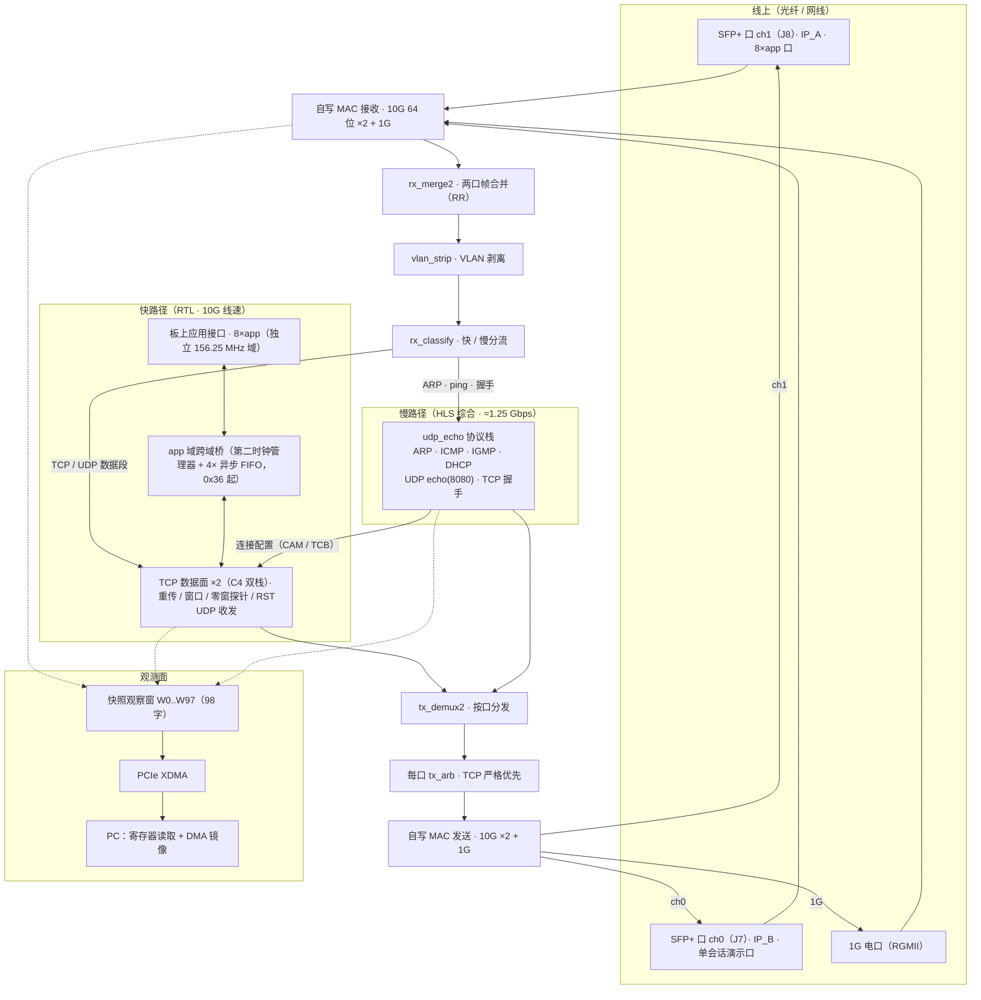

# 10g_fpga_tcp_ip_stack — 纯硬件 TCP/IP 数据面（1G 已验收 · 10G 双口达标 · 8×app 双栈已板级验证 · PCIe 通路已打通）

## 这是什么

一块 **XCKU5P** FPGA 开发板（Kintex UltraScale+ 系列芯片，板载 2 个 SFP+ 万兆光纤插槽、1 个千兆电口、1 条 PCIe x4 插槽），
上面用 Verilog 硬件描述语言实现了一整套 **TCP/IP 协议栈数据面**：万兆光口（官方物理层 IP + 自写 64 位 MAC——
即以太网"媒体访问控制器"，负责成帧/校验的硬件模块）与千兆电口（RGMII 接口：千兆电口的标准接法）两个前端，
共用同一条 64 位数据流水线（ARM AXI-Stream 流格式：一拍拍传数据、带握手机制，每时钟周期处理一个字）。
TCP/UDP 数据段走纯硬件快路径；ARP、ping、TCP 握手等慢速控制包走用 C 语言编写、经高层综合（HLS，"用 C 代码自动生成硬件"的工具）生成的硬件协议栈。
板子插在 PC 的 PCIe 插槽上，PC 通过由 **98 个** 32 位寄存器组成的观察窗口读取板内计数器与状态（像读内存一样访问；
窗口规模随代际演进 63→…→76→85→98 字，现役构建 0x3B）——本板没有串口，这是唯一观测手段。

## 协议功能全景

| 协议 | 分层 | 实现位置 | 范围与状态 |
|---|---|---|---|
| 以太网 MAC（成帧 / FCS） | 链路层 | 自写 RTL | 10G：64 位 XGMII，线速达标（813,794.7 帧/s，载荷 9.531 Gbps）；1G：RGMII，已验收（956.0 Mbps）；**双 SFP+ 第二口已板级验证**（2026-10-27 D9R：双口同时各下行 8.94 Gbps） |
| VLAN（0x8100 / 0x88A8） | 链路层 | RTL（vlan_strip） | 已实现：识别并剥离标签；带标签帧走慢路径 |
| ARP | 网络层 | HLS 慢路径 | 已实现：请求应答 |
| IPv4 | 网络层 | 快路径 RTL（数据段）+ HLS 慢路径（其余） | 单 IP 已验收；双板 IP（IP_A / IP_B）随 C4 双栈实施，双口板级灌流已通过（D9R）；**8×app 独立时钟域（跨时钟域桥）已板级验证（0x36/0x3B）** |
| ICMP（echo） | 网络层 | HLS 慢路径 | 已实现：ping 应答 |
| IGMP v1 / v2 | 网络层 | HLS 慢路径 | 已实现；v3 不支持 |
| DHCP 客户端 | 应用层 | HLS 慢路径 | 已实现 |
| UDP | 传输层 | 快路径 RTL（收发主体）+ HLS echo（8080）参考实现 | 已验收：1G 956.0 Mbps；10G 线速达标 |
| TCP | 传输层 | 快路径 RTL（数据面）+ HLS 慢路径（握手等控制面） | 1G 已验收；10G 业务实测通过。含：被动 / 主动握手、数据收发、重传、窗口缩放、零窗探针、RST、孤儿会话回收、**每连接在飞上限 61,440 B（≈42 个满帧）与窗口配额管理器**；**8 连接并发已在真 8×app 口板级验证（0x3B：干净态 8/8 收满）**；同时 SYN 处理为已知弱点（见「已知边界」） |

慢路径整体限速 ≈1.25 Gbps（64 位字入、1 字节/拍出）：ARP / ping / 握手等控制面流量足够，不承载批量数据。

## 数据通路（数据流一览）

实线 = 数据流；点线 = 计数器 / 观测。纵向为数据流向；双 SFP+ 口已板级验证（2026-10-27 D9R），8×app 独立时钟域已板级验证（2026-10-29 起 0x36），其余为现役结构。

## 当前状态

- **板上现役 = 构建 `0x3B`**：C4 双栈 + 8×app 独立时钟域跨域桥 + 复用 W51..W53 的逐槽诊断字；
  快照观察窗 **98 字**（W0..W97，W97 = 8×app 跨域健康字）/ 未实现地址 `0x1B8`，
  板卡 `0x08 = 0`（未受控停流）、`carrier = 1/1`（两个光口链路均 up）、时序余量 WNS +0.027。
  每次测量前重烧位流并核对 sha256 与板侧构建编号（BID），是本仓铁律
  （源：台账 §10-184～§10-187；`_proj_10g/notes/p11_txstarve_20261103/REPORT_0x3B_diag.md`）。
- **1G 数据面**：已板级正式验收，35 条判据全过，956.0 Mbps。
- **10G 方向**：物理层验收通过（误码率上界 4.997×10⁻¹³）→ 线速达标（813,794.7 帧/秒，线上载荷 9.531 Gbps）→
  业务实测、长时发送通过；四条真实缺陷已修复并经板级验证（时钟管理器失锁重锁、RFC 序号回绕比较、连续模式换流时序、MDIO 工具链）。
  P11 前半（2026-10-18 起）：双 SFP+ 第二口接入 → C4 双栈位流线——0x2F 构建时序失败（WNS −6.456，根因 = 窗口配额
  管理器单组合链 42 级）⇒ 管理器重写为事件机 + 0x31/0x32 构建通过；构建脚本新增**时序硬门**（不达标位流自动改名隔离、禁烧）
  与 **TCB 写口族定向时序门**（源：`_proj_10g/notes/p11_fix_0x30_0x31_20261025/README_FOR_TL.md`；`p11_fix_0x31_rom_0x32_20261026/README_FOR_TL.md`）。
- **P11 里程碑：8×app（8 连接应用）全链收口（2026-10-27 ～ 2026-11-05）**：
  - 尾延迟两代仪器：E1（0x32）证 9G 慢态负载**不抬高**慢路径控制面 p99（ping/TCP connect/UDP 各档负载下反而更低，0 丢包）；
    E1a-1（构建 0x33）给快路径装上逐帧发送延迟直读仪器——满载 68,493,653 帧下 **p50/p99 全落 384–511 拍 = 2.46–3.27 µs**。
  - **8×app 时序墙**：8 个 app 挤在数据面时钟域的方案（0x34）四次构建全部时序失败（最好 −0.205 ns）⇒ 架构结论"同域不可行"；
    改走方案 A——8×app 移入**独立 156.25 MHz 时钟域**（第二个时钟管理器 + 4 条异步 FIFO 跨域桥 + W97 健康字），
    设计经三轮独立对抗审查（v1→v5）后实施。
  - **0x36 构建通过（WNS +0.017，app 域自身 +0.39）+ 板级全过**：身份判据全中、W97 健康字干净（=0x20）、
    100 条串行连接 107,052,876 B 零失配、**8 连接并发 seq 模式 8/8**（零失配零停顿）、上行 8×12,288 B 零失配；
    常驻仿真矩阵 41/41 冻结校验通过（400 个指纹文件逐字节不变）。
  - **"8 连接并发上限 2–4"大反转**：0x3B 诊断构建上板后发现，历史上全部 8 连接测试都打错了口——**.4 口是单会话演示口、
    .2 口才是真 8×app 口**；在 .2 口干净态实测 **8/8 连接全部收满**（8×16 MB 一轮 + 8×256 MB 错开，单连接峰值 4.6–9.1 Gbps）。
  - **数据面时序收口**：三个诊断构建全被"既有数据面余量极小（+0.017 ns）的时序"挡死后，按用户裁定走实现策略收口——
    同一综合网表并行三种布局策略，`Congestion_SpreadLogic_high` 过门（WNS +0.027、失败端点全 0）⇒ **0x3B 可烧、已烧**。
  - 如实登记：0x37（每连接占用计数开）构建时序失败（路由拥塞）禁烧；**同时到达的两个 SYN 慢路径只应答其一**
    （空闲态 3/3 复现，connect 耗时呈 0.1 ms→4.1 s 阶梯）——8 连接产品目标的头号已知弱点（见「已知边界」）。
  （源：台账 §10-167～§10-187；`_proj_10g/notes/p11_e1_latency_20261027/`；`p11_e1a_design_20261027/`；
  `p11_app8_contract_20261027/`；`p11_app8_cdc_20261029/`；`p11_txstarve_20261103/`；`p11_timing_close_20261105/`。）
- **双口板级达标（D9R，2026-10-27）**：双 SFP+ 口同时各下行 10 GB，A 口 8.9367 / B 口 8.9352 Gbps
  （host 侧合计 17.8719 Gbps），逐字节零失配、无停顿（源：`_proj_10g/notes/p11_board_p3_0x32_20261026/raw/`；台账 §10-165）。
- **E0.5 满载延迟基线（2026-10-27）**：单连接单口下行 9.44 Gbps 级 = 线上载荷天花板 9.49285 Gbps 的 99.45–99.50%
  （sink 侧墙钟 ±0.2% 误差棒；板侧以拍钟为准），TX 线 99.86% 时间在忙；四跑 24 GB + 两跑 60 GB 合计
  **216 GB 逐字节零失配**。发现**快 / 慢两个连接级稳态**（6 连接 = 3 快 3 慢，各态可在单连接内持续 ≥40 s）：
  慢态空闲的 92–93% 是在等板自己的窗口（在飞上限 61,440 B ≈ 42 个满帧），**整窗排空最坏 52 µs**
  （随机到达的附加等待 ∈ [0, 52] µs、均值约 26）——结构最坏值，不是实测尾延迟；快 / 慢态翻转机理【未定位】
  （源：`_proj_10g/notes/p11_e05_latency_20261027/README_FOR_TL.md`；台账 §10-165/§10-166）。
- **PCIe 数据通路**：「SFP+ → 板上协议栈 → PCIe → 驱动 → PC 程序」链路已打通，
  镜像载荷在 UDP/TCP 两种来源、任意字节对齐下逐字节零失配；线速档 PC 侧单探针 8.66 Gbps（入口速率的 94%）；
  URAM 板内缓冲（32 KB）把丢字节量降低 单源 56% / 4 源 33%（同会话对照归因 62% / 52%）。
- **孤儿会话修复完成**：对端失联后未被板卡回收、持续占用槽位的会话，现在有失联判据回收机制
  （回收连接状态、CAM 表项与配额），观测窗新增 W75 = 孤儿会话回收计数。板级对照验证正结果：
  修复版在失联约 61.7 s 后回收（两次独立复现）且新连接恢复 802 Mbps 满速零失配；旧版（0x28）不回收、槽位卡死。

## 怎么跑

- 两分钟了解现状、五分钟查到指标 → [docs/INDEX.md](docs/INDEX.md)（人读层总索引）。
- 仿真检查（常驻矩阵 **41 门**，一跑给出通过/失败判决）→ `sim/p4gates/run_matrix_p4dfix.bat`；
  出位流 → `board/run_build_p7b_ku5p.bat`；板级工具在 `tools/` 与 `_proj_pcie/p7b_biz/`。
- AI 会话入口 → `agent_docs/P6B_SUMMARY.md`（1G 验收一页式）与 `agent_docs/PORT_NOTES.md`（逐日施工流水）；
  施工纪律 → `CLAUDE.md`。
- 最新续接点与未结项一律以两份权威件为准：`_proj_10g/notes/P7B_TL_LEDGER_20261010.md`（台账，最新 §10-187）、
  `_proj_10g/notes/P7B_OPEN_ITEMS.md`（未结项总表）。

## 文档索引

| 入口 | 一句话说明 |
|---|---|
| [docs/INDEX.md](docs/INDEX.md) | 人读层总索引（docs/ 五件导读 + agent_docs/ 与 notes/ 导读） |
| [docs/progress.md](docs/progress.md) | 施工进度时间线（按日期分节） |
| [docs/metrics.md](docs/metrics.md) | 指标汇总：速率 / 时延 / 资源 / 时序 / 判据达成，全部注明出处 |
| [docs/modules.md](docs/modules.md) | 模块划分：每个模块是什么 / 功能 / 接口 / 关键指标 / 已知缺陷 |
| [docs/glossary.md](docs/glossary.md) | 术语对照表：技术词平白解释 + 项目黑话翻译（黑话只许出现在这一份） |
| [docs/HUMAN_LAYER.md](docs/HUMAN_LAYER.md) | 人读层清单与审查规则 |
| [agent_docs/P6B_SUMMARY.md](agent_docs/P6B_SUMMARY.md) | 1G 数据面验收一页式总览 |
| [agent_docs/PORT_NOTES.md](agent_docs/PORT_NOTES.md) | 全仓施工流水账与教训（逐日分节） |
| [agent_docs/P7B_SPEC.md](agent_docs/P7B_SPEC.md) | 10G 数据面施工规格（阶段关卡判据表） |

## 已知边界（未测 / 未判定项照实，全文见 `_proj_10g/notes/P7B_OPEN_ITEMS.md` 与台账）

- **同时 SYN 单应答【已证·未修】**：慢路径一次只应答一个同时到达的 SYN、其余被丢（不排队），空闲态 3/3 复现；
  多条连接同时发起时 connect 耗时呈 0.1 ms→4.1 s 阶梯（被丢的连接靠 1 s 重传建立），数据占线下放大到 3.1 s。
  修复（SYN 排队 + 板侧 SYN 观测计数器）需一次构建（源：台账 §10-187）。
- **每连接占用计数（OCC=1）未交付**：0x37 构建时序失败（路由拥塞级 5、WNS −0.629）被禁烧；
  0x36/0x3B 现役构建中该功能关闭（源：台账 §10-174）。
- **会话累积疑似槽泄漏【未判定】**：同一会话跑数十次连接后，并发 connect 出现 SYN 无应答（pcap 见证）、重烧位流恢复；
  候选 = 慢路径半开连接槽泄漏；首跑 2/8 在后续 4 次复跑均未复现，**不判已解决**（源：台账 §10-180/§10-186）。
- **快 / 慢态翻转机理【未定位】**：满载单连接存在 9.44 Gbps（快）与 9.07–9.26 Gbps（慢）两个连接级稳态，
  与对端 ACK 稀疏程度相关但无逐包见证；候选 = 对端 ACK 路径动力学（唯一与全部板侧证据相容）/ RSS 队列与核亲和；
  p99 尾延迟【未测】（E0.5 只有占空/计数器）（源：`p11_e05_latency_20261027/README_FOR_TL.md` §3）。
- **观测口径**：W69（等窗操作点锁存）不可用——单点锁存且被"扫描拍陈旧样本"污染，W66/W67 的"非板帽侧"读数
  含约 1/16 的扫描伪拍，不能直接读作对端通告窗（源：同件 §1.1/§3.2；kimi xr11 审查 H-1/H-2 及回灌）。
- **双口窗归因**：窗口等待计数器只接了 A 口，口 B 结构性无窗归因仪器；双口同时满载的窗归因【未测】；
  8×12KB 多连接配额合同【未测】（源：同件 §3.3）。
- **低速吞吐区**（大批量传输中速率掉到 ~1 Mbps 低位的异常区间）：进入条件已证（两条连接并行抢流，两次独立复现）、
  重烧位流可清除、大接收缓冲的连接免疫；板侧机理【未定位】。"零窗占比是主因"获预注册判据支持（分水岭在接收缓冲 7000→8000），
  但 12000 档实测为第二慢区 ⇒ 零窗不是唯一轴，因果方向【未判定】。
- **P-3**（换流复位被同拍装配写覆盖）：板级判据迄今未获有效判别力【未测】，去向（继续实验 / 转设计侧）留用户裁定。
- **孤儿会话修复残余**：空闲死对端（inflight=0）不回收（F6-a 未闭）；两个长时压力臂（B5b / B5c）未跑；
  app 内部 closing/active 无快照字，自愈只有行为面证据。
- 1G 时代遗留的接收方向字节损坏专题未结（`agent_docs/ISSUE_RX_BYTE_CORRUPTION.md`，机制未证实）。
